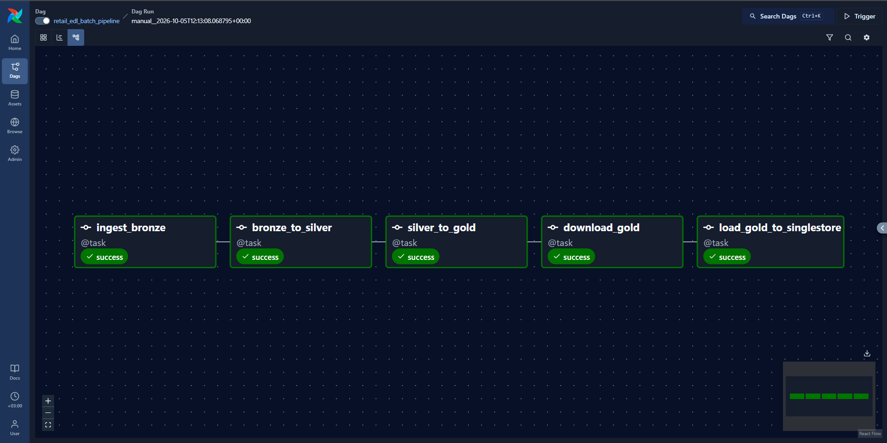
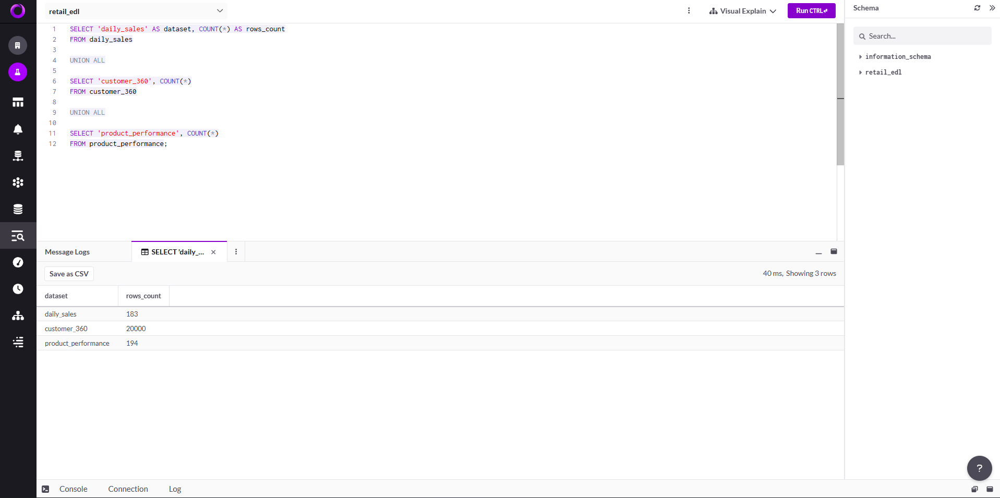
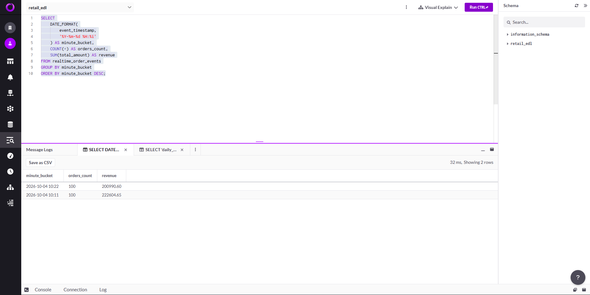

# Enterprise Retail EDL with SingleStore

An end-to-end Enterprise Data Lake project that combines batch data processing and real-time streaming using PostgreSQL, RustFS, PySpark, Apache Airflow, Apache Kafka, and SingleStore.

The project demonstrates how retail data can be ingested, transformed through Bronze, Silver, and Gold layers, orchestrated with Airflow, and served in SingleStore for analytical and real-time workloads.

---

## Tech Stack

- Python
- PostgreSQL
- RustFS
- PySpark
- Apache Airflow
- Apache Kafka
- SingleStore
- Docker
- Parquet

---

## Batch Data Pipeline

The batch pipeline processes data from PostgreSQL and an external products API.

```text
PostgreSQL + Products API
          ↓
       Bronze
          ↓
       Silver
          ↓
        Gold
          ↓
     SingleStore
```

### Bronze Layer

Raw source data is ingested from:

- PostgreSQL
  - Customers
  - Orders
  - Order Items
- External Products API

The datasets are stored in RustFS object storage.

### Silver Layer

PySpark is used to:

- Read Bronze datasets
- Apply data quality rules
- Clean and standardize records
- Prepare trusted datasets
- Store the results as Parquet

### Gold Layer

The Silver datasets are transformed into analytical datasets:

- `daily_sales`
- `customer_360`
- `product_performance`

These datasets are then loaded into SingleStore.

---

## Airflow Orchestration

Apache Airflow orchestrates the complete batch workflow.

The DAG:

`retail_edl_batch_pipeline`

contains the following tasks:

```text
ingest_bronze
      ↓
bronze_to_silver
      ↓
silver_to_gold
      ↓
download_gold
      ↓
load_gold_to_singlestore
```

### Successful DAG Run



---

## SingleStore Analytical Layer

SingleStore is used as the analytical serving layer for the Gold datasets.

The main analytical tables are:

- `daily_sales`
- `customer_360`
- `product_performance`

### Gold Tables



SingleStore enables fast SQL analytics over the curated retail datasets.

---

## Real-Time Streaming

The project also includes a real-time streaming pipeline.

```text
Python Producer
      ↓
Apache Kafka
      ↓
SingleStore Pipeline
      ↓
realtime_order_events
      ↓
Real-Time SQL Analytics
```

A Python producer generates retail order events and sends them to the Kafka topic:

`order_events`

A SingleStore Pipeline continuously consumes the Kafka events and loads them into:

`realtime_order_events`

This enables near real-time analytical queries directly inside SingleStore.

### Real-Time Analytics



---

## Project Structure

```text
enterprise-retail-edl-singlestore/
│
├── airflow/
│   ├── dags/
│   ├── Dockerfile
│   └── requirements.txt
│
├── docs/
│   └── screenshots/
│
├── postgres/
│   └── schema.sql
│
├── scripts/
│   ├── generate_source_data.py
│   ├── ingest_bronze.py
│   ├── download_gold.py
│   ├── kafka_producer.py
│   └── load_gold_to_singlestore.py
│
├── spark/
│   ├── bronze_to_silver.py
│   └── silver_to_gold.py
│
├── singlestore/
│
├── .env.example
├── .gitignore
├── docker-compose.yml
└── README.md
```

---

## Environment Variables

Sensitive credentials are not stored in the repository.

Create a local `.env` file using:

```bash
cp .env.example .env
```

Then configure the required values.

Example variables:

```env
POSTGRES_USER=
POSTGRES_PASSWORD=
POSTGRES_DB=

RUSTFS_ACCESS_KEY=
RUSTFS_SECRET_KEY=

SINGLESTORE_USER=
SINGLESTORE_PASSWORD=
SINGLESTORE_DATABASE=
```

The `.env` file is excluded from Git using `.gitignore`.

---

## Running the Project

Start the Docker environment:

```bash
docker compose up -d
```

Check the running services:

```bash
docker compose ps
```

Main local interfaces:

- Airflow: `http://localhost:8081`
- SingleStore Studio: `http://localhost:8080`
- RustFS Console: `http://localhost:9001`

---

## Key Features

- End-to-end retail data engineering pipeline
- Bronze, Silver, and Gold data layers
- Object storage with RustFS
- Distributed transformations using PySpark
- Workflow orchestration using Apache Airflow
- Kafka event streaming
- SingleStore Pipelines
- Real-time SQL analytics
- Batch and streaming workloads in one project
- Dockerized local development environment
- Environment-based secret management